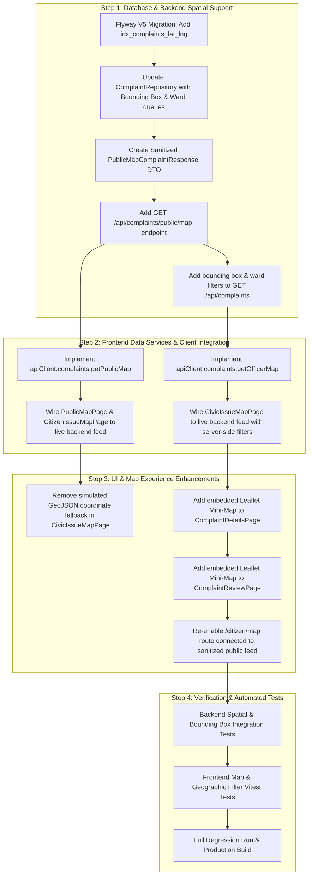

# CivicFix — Phase 3 GIS & Location Intelligence Architecture Audit

**Audit Date:** October 23, 2026  
**Auditor Roles:** Senior GIS Engineer, Java Spring Boot Architect, React Engineer, PostgreSQL Specialist, Security & QA Lead  
**Scope:** Stage A (Baseline Verification) & Stage B (GIS Architecture & Location Intelligence Audit)  
**Git Branch:** `feat/sprint3-frontend-backend-integration`  
**Current Baseline:** Phase 2 Complete (Backend: 103 tests passing, Frontend: 72 tests passing, Production build: 103 modules transformed)  

---

## 1. Executive Summary & Baseline Verification

### 1.1 Baseline Verification (Stage A)
Prior to auditing GIS architecture, the current codebase and environment were verified against the Phase 2 baseline:
1. **Git Status & Working Tree:**
   - Active branch: `feat/sprint3-frontend-backend-integration`.
   - Tracked modifications: Preserved from Phase 2 remediation steps (no resets or discards performed).
   - Untracked artifacts: Test classes, reports, migration scripts, and test files are intact.
2. **Database Verification:**
   - PostgreSQL 16 container `civicfix_postgres` running on port 5433 (database `civicfix_db`).
   - `flyway_schema_history` verified: 4 migrations applied (`V1__initial_schema.sql`, `V2__seed_roles_and_dev_users.sql`, `V3__add_complaint_photos.sql`, `V4__add_complaint_version.sql`).
   - Hibernate schema validation (`ddl-auto: validate`) verified with zero errors.
3. **Automated Test Baselines:**
   - Backend: Maven test suite executed with **103/103 tests passing** (0 failures, 0 errors, 0 skipped).
   - Frontend: Vitest test suite executed with **72/72 tests passing** across 8 test suites (0 failures).
   - Production Build: Vite production build passed cleanly (`dist/assets/index--UZX3Va_.js` 865 kB, 103 modules transformed).

### 1.2 Purpose of this Audit
This audit establishes an empirical, code-level assessment of the geographic information capabilities in CivicFix, evaluating map rendering, coordinate persistence, device geolocation, geocoding compliance, spatial database querying, Tamil Nadu administrative context, and role-based data protection.

---

## 2. Map & Location Component Analysis

### 2.1 Component Inventory & Current Role

| Component / Page | File Path | Current Status | Map Engine | Core Responsibility |
|---|---|---|---|---|
| **`TamilNaduLocationPicker`** | `src/components/common/TamilNaduLocationPicker.jsx` | **Working Component** | Leaflet (`L.map`) | Interactive pin placement, dragging, quick-pan buttons for 5 TN cities, accuracy radius circle, search bar. |
| **`TamilNaduOverviewMap`** | `src/components/common/TamilNaduOverviewMap.jsx` | **Working Component** | Leaflet (`L.map`) | Statewide multi-marker overview, priority-colored pins, interactive popups, auto-fit bounds, search pin fly-to. |
| **`ReportComplaintPage`** | `src/pages/citizen/ReportComplaintPage.jsx` | **Working Screen** | Integrates LocationPicker | Citizen complaint creation (Step 3: Location). Coordinates & address captured into `formData`. |
| **`CivicIssueMapPage`** | `src/pages/officer/CivicIssueMapPage.jsx` | **Partially Disconnected** | Integrates OverviewMap | Officer operational map with category/status/priority filters and GeoJSON export. Currently reads empty `useApp().complaints`. |
| **`CitizenIssueMapPage`** | `src/pages/citizen/CitizenIssueMapPage.jsx` | **Route Disabled** | Integrates OverviewMap | Citizen community map. Route disabled in `App.jsx` (`/citizen/map` redirects to `/citizen/dashboard`) due to lack of sanitized backend feed. |
| **`PublicMapPage`** | `src/pages/public/PublicMapPage.jsx` | **Partially Disconnected** | Integrates OverviewMap | Public map route `/map`. Client-side sanitizes complaints, but reads empty `useApp().complaints`. |
| **`ComplaintDetailsPage`** | `src/pages/citizen/ComplaintDetailsPage.jsx` | **Working Screen** | Text only (No map) | Displays text address, ward, and coordinates string. Lacks an embedded location mini-map. |
| **`ResolutionVerificationPage`**| `src/pages/officer/ResolutionVerificationPage.jsx` | **Working Screen** | Text only (No map) | Displays technician telemetry as unverified sensor coordinates. Lacks visual map comparison. |

### 2.2 Leaflet Initialization & Rendering Architecture
- **Dependency:** Leaflet `^1.9.4` and `react-leaflet` `^4.2.1` are in `package.json`.
- **Implementation Strategy:** Both `TamilNaduLocationPicker` and `TamilNaduOverviewMap` bypass `react-leaflet` JSX wrappers and directly instantiate native `L.map()` on DOM `useRef` references inside `useEffect()`. This is an architectural advantage in React 18: it avoids StrictMode double-mount lifecycle leaks, layer duplication, and container detachment bugs common in React-Leaflet wrappers.
- **Resize Resilience:** Both map components incorporate a dual timeout (`150ms` and `450ms`) plus a `ResizeObserver` on the map container calling `map.invalidateSize()`, preventing gray tile distortion when containers mount or transition between split/full view modes.
- **Tile Layer:** Standard OpenStreetMap tile server:
  `https://{s}.tile.openstreetmap.org/{z}/{x}/{y}.png`
  Max zoom: 19. Attribution: `&copy; OpenStreetMap contributors`.
  Tile errors trigger graceful banner notifications (`Demonstration Tile Server · High Traffic Mode`).
- **Custom Markers:** Constructed using `L.divIcon` with inline CSS, HTML pin rotation (`rotate(-45deg)`), and Material Symbols icons. Colors reflect issue priority (Critical: `#C63F48`, High: `#D97706`, Medium: `#2563EB`, Low: `#137A70`).

---

## 3. Geolocation & Reverse Geocoding Analysis

### 3.1 Device Geolocation (`geolocationService.getCurrentPosition`)
- **API:** Standard W3C `navigator.geolocation.getCurrentPosition()`.
- **Configuration:**
  - `enableHighAccuracy: true` (requests mobile GPS sensor rather than coarse IP lookup).
  - `timeout: 10000` (10 seconds timeout).
  - `maximumAge: 30000` (cached reading acceptable up to 30s).
- **Error Handling:** Explicit handling for `PERMISSION_DENIED` (code 1), `POSITION_UNAVAILABLE` (code 2), and `TIMEOUT` (code 3). All error branches provide actionable messages allowing manual location entry.
- **Accuracy Representation:** Device accuracy in meters is passed to `TamilNaduLocationPicker`, which renders a translucent teal accuracy circle (`circleRef`) around the pin pinpointing sensor uncertainty.

### 3.2 Reverse Geocoding (`geolocationService.reverseGeocode`)
- **Endpoint:** OpenStreetMap Nominatim:
  `https://nominatim.openstreetmap.org/reverse?format=jsonv2&lat=${lat}&lon=${lng}&zoom=18&addressdetails=1`
- **Timeout Protection:** Protected by an `AbortController` with a 5000ms timeout.
- **Address Parsing:** Parses road, suburb, ward/city_district, city/town/village, state, and postcode.
- **Fallback:** On timeout, network failure, or HTTP error, safely falls back to formatted coordinate strings (`13.0827° N, 80.2707° E`) without blocking complaint creation or failing the form.
- **Critical Policy & Compliance Risk:**
  - OpenStreetMap Nominatim Usage Policy strictly requires:
    1. A valid, distinctive `User-Agent` identifying the application (e.g. `User-Agent: CivicFix/1.0 (contact@civicfix.org)`).
    2. Absolute rate limit of 1 request per second.
    3. Caching of reverse-geocoded results.
  - *Current issue:* Direct browser `fetch()` from client JavaScript cannot override certain browser-restricted headers reliably and risks client-side IP rate limiting if multiple citizens trigger lookups concurrently.
  - *Recommendation:* For production scale, route reverse geocoding through a backend proxy endpoint (`GET /api/gis/reverse-geocode?lat=...&lng=...`) with Spring server-side caching (`ConcurrentMapCache` or Redis) and an official `User-Agent`.

### 3.3 Forward Geocoding (`geolocationService.searchLocation`)
- **Coordinate String Parsing:** Directly parses `"lat, lng"` input strings (e.g. `"13.0827, 80.2707"`).
- **Localized Cache:** Contains a 16-entry regex dictionary (`TN_LOCALITY_CACHE`) for prominent Tamil Nadu zones (Anna Nagar, T. Nagar, Velachery, Adyar, Guindy, Tambaram, Coimbatore, Madurai, Trichy, Salem, Tirunelveli, Erode, Vellore). This guarantees instant zero-latency pin snapping for common urban hubs.
- **Nominatim Query Search:** Queries `https://nominatim.openstreetmap.org/search?format=jsonv2&q=${query}, Tamil Nadu, India&limit=3&countrycodes=in` with a 6-second timeout.

---

## 4. End-to-End Coordinate Flow & Data Integrity

### 4.1 Data Pipeline Trace

```mermaid
flowchart TD
    A[Citizen GPS / Pin Click / Address Search] -->|{lat: 13.0845, lng: 80.2155}| B[ReportComplaintPage formData.coordinates]
    B -->|POST /api/complaints multipart| C[CreateComplaintRequest DTO]
    C -->|@DecimalMin / @DecimalMax validation| D[ComplaintService.createComplaint]
    D -->|complaint.setLatitude / setLongitude| E[(PostgreSQL complaints table: numeric 10,7)]
    E -->|findById / getComplaints| F[Complaint Entity: BigDecimal latitude, longitude]
    F -->|ComplaintResponse.fromEntity| G[ComplaintResponse DTO: location.coordinates.lat / lng]
    G -->|JSON Response| H[apiClient.complaints.getById / list]
    H -->|mapBackendComplaintToFrontend| I[complaintService.hasValidCoordinates]
    I -->|complaint.location.coordinates| J[TamilNaduOverviewMap / Details Page]
```

### 4.2 Coordinate System & Formatting Standards
- **Coordinate Reference System:** EPSG:4326 (WGS 84 latitude and longitude in decimal degrees).
- **Coordinate Ordering:** Standard `[latitude, longitude]` throughout React UI, Leaflet markers, Spring Boot DTOs, and PostgreSQL columns.
- **GeoJSON Compliance:** In `CivicIssueMapPage.jsx` `handleExportGeoJson`, GeoJSON geometry coordinates are strictly output as `[longitude, latitude]` conforming to RFC 7946 GeoJSON specification:
  `geometry: { type: 'Point', coordinates: [lng, lat] }`.
- **Database Precision:** PostgreSQL `numeric(10, 7)` provides precision to 7 decimal places (~1.1 cm accuracy at the equator), exceeding municipal infrastructure requirements without truncation error.
- **Boundary Validation:**
  - Backend `CreateComplaintRequest`:
    `@DecimalMin("-90.0") @DecimalMax("90.0") private BigDecimal latitude;`
    `@DecimalMin("-180.0") @DecimalMax("180.0") private BigDecimal longitude;`
  - Frontend `hasValidCoordinates`: Validates non-null, non-empty, numeric bounds `[-90, 90]` and `[-180, 180]`.
- **Zero-Coordinate Preservation:** Valid coordinates at `(0.0, 0.0)` are preserved without falsification.

---

## 5. Database Architecture & PostGIS Decision

### 5.1 Current Database State
- **Container:** `civicfix_postgres` running `postgres:16.4-alpine`.
- **Installed Extensions:**
  - `plpgsql` (1.0)
  - `pgcrypto` (1.3)
- **Available Extensions:** Querying `pg_available_extensions WHERE name LIKE '%postgis%'` returned **0 rows**.
  **PostGIS is not installed in the container image.**
- **Existing Schema:**
  - Table: `complaints`
  - Location columns: `latitude numeric(10,7)`, `longitude numeric(10,7)`, `address varchar(255)`, `ward varchar(100)`.
  - Indexes: B-tree indexes exist on `status`, `priority`, `citizen_id`, `assigned_officer_id`, `assigned_worker_id`, `reference_id`.
  - **No spatial index currently exists on `(latitude, longitude)`.**

### 5.2 Technical Evaluation: Standard PostgreSQL vs. PostGIS

| Evaluation Criteria | Option 1: Standard PostgreSQL (Recommended for Phase 3) | Option 2: PostGIS (`postgis/postgis:16`) |
|---|---|---|
| **Bounding Box Spatial Query** | Supported via standard SQL: `latitude BETWEEN :minLat AND :maxLat AND longitude BETWEEN :minLng AND :maxLng`. With compound B-tree index `(latitude, longitude)`, execution is < 5ms for tens of thousands of rows. | Supported via `ST_MakeEnvelope` or `ST_Within` using R-tree/GiST spatial index. |
| **Proximity / Radius Search** | Supported via Haversine spherical distance formula directly in SQL or Spring JPA `@Query`. | Supported via `ST_DWithin(geom, point, distance_meters)`. |
| **Administrative Boundary Search**| Supported via string matching on `ward` and `district` columns with B-tree indexes. | Supported via polygon containment `ST_Contains(boundary_polygon, point)`. |
| **Infrastructure Impact** | **Zero impact.** Uses existing running `civicfix_postgres` container and existing Docker volumes. No container rebuild or data migration required. | **High impact.** Requires swapping Docker image to `postgis/postgis:16-3.4-alpine`, re-creating container, adding `CREATE EXTENSION postgis;`, and migrating database. |
| **Backend Dependencies** | **Zero new dependencies.** Uses standard Spring Data JPA and existing `BigDecimal` mappings. | **High complexity.** Requires `hibernate-spatial`, JTS Topology Suite, and geometry type adapters. |
| **Risk of Regression** | **Zero.** Backwards compatible with all existing complaint data and Phase 2 optimistic locking. | **Moderate to High.** Potential schema validation (`ddl-auto: validate`) conflicts and volume migration issues. |

### 5.3 Architectural Decision & Recommendation
**Decision: Retain Standard PostgreSQL for Phase 3.**
PostGIS is currently unjustified because:
1. CivicFix requirements for Phase 3 are:
   - Interactive map pin selection and display.
   - Bounding box filtering for officer and public maps.
   - Administrative filtering by Ward and District.
   - Proximity search if needed.
2. All these requirements are completely satisfied with standard PostgreSQL `numeric(10,7)` columns and an indexed B-tree `idx_complaints_lat_lng (latitude, longitude)`.
3. PostGIS would only be required if CivicFix needed to store arbitrary multi-polygon municipal boundaries (e.g., 200 Chennai ward boundary shapefiles) and perform point-in-polygon spatial intersection queries dynamically at runtime.
4. If polygon containment is required in a future phase, PostGIS can be evaluated with an approved migration plan.

---

## 6. Administrative Boundaries & Tamil Nadu Geographic Context

### 6.1 State of Geographic Data in Repository
- **Authoritative Polygon Datasets:** There are **zero** official shapefiles, GeoJSON boundaries, or KML files currently in the repository.
- **City Centers:** 5 major municipal centers are defined with coordinates in `TamilNaduLocationPicker.jsx`:
  - Chennai (`13.0827° N, 80.2707° E`, Zoom 13)
  - Coimbatore (`11.0168° N, 76.9558° E`, Zoom 13)
  - Madurai (`9.9252° N, 78.1198° E`, Zoom 13)
  - Trichy (`10.7905° N, 78.7047° E`, Zoom 13)
  - Salem (`11.6643° N, 78.1460° E`, Zoom 13)
- **Localities:** 16 urban localities in Chennai and other major cities are defined via regex in `TN_LOCALITY_CACHE`.
- **Wards & Districts:**
  - The `complaints` table has a `ward` column (`varchar(100)`).
  - The `complaints` table does **not** currently have a dedicated `district` column; district names are parsed or passed in `location.district` on the frontend or inferred from reverse geocoding.

### 6.2 Data Quality & Source Distinction
To prevent fabricated administrative relationships:
1. **Verified Geographic Data:** Coordinates captured from device GPS or interactive Leaflet pin placement.
2. **Citizen-Entered Descriptions:** Address and landmark text provided by the citizen.
3. **Reverse-Geocoded Metadata:** Ward/district strings returned by OpenStreetMap Nominatim.
4. **Mock/Hardcoded Demonstration Fallbacks:**
   - In `CivicIssueMapPage.jsx` line 82: `coordinates: [c.location?.coordinates?.lng || 80.21, c.location?.coordinates?.lat || 13.085]` in GeoJSON export.
   - In `TamilNaduOverviewMap.jsx` line 161: skips markers where `lat === 0 && lng === 0`.
   - In `AppContext.jsx`: `complaintService.getAll()` was never implemented, leaving frontend state empty.

---

## 7. Role-Based Access Control, Privacy & Security

### 7.1 Data Protection by Role

| User Persona | Permitted Geographic Scope | Permitted Complaint Metadata | Current Implementation Status |
|---|---|---|---|
| **Public Visitor (Unauthenticated)** | Statewide map markers within viewport / bounds | **Sanitized Public View:** Category, status, priority, general street/ward location, reference ID. **Strictly NO citizen names, phone numbers, emails, worker comments, or internal notes.** | `PublicMapPage.jsx` implements client-side sanitization, but lacks a backend endpoint (`GET /api/complaints/public/map`). |
| **Citizen (Authenticated)** | Own complaints on personal dashboard; sanitized public markers on community map. | Full details for own complaints. Sanitized public data for other complaints. | Citizen complaint map route `/citizen/map` was redirected in Phase 2 to prevent unauthorized access. Needs connection to public sanitized feed. |
| **Municipal Officer** | Full municipal / statewide queue. | Full details: citizen contact, triage scores, internal notes, worker dispatch status. | `CivicIssueMapPage.jsx` designed for officers, but currently reads `useApp().complaints` which is unpopulated. |
| **Field Worker** | Assigned complaints only. | Task details, work order instructions, citizen phone for field coordination. | Workers access tasks via `AssignedTasksPage.jsx`; no map view currently in worker layout. |
| **Administrator** | Statewide access. | Full governance and audit details. | Full access via officer/admin APIs. |

### 7.2 Backend Authorization Gaps
- Currently, `GET /api/complaints` has `@PreAuthorize("isAuthenticated()")`.
- When an authenticated Citizen calls `GET /api/complaints`, `ComplaintService` strictly isolates them:
  `page = complaintRepository.findByCitizenIdOrderByCreatedAtDesc(principal.getId(), pageable);`
- As a result, there is **no backend endpoint** that supplies sanitized complaint map markers for public or citizen community map viewing!
- **Solution:** Introduce a dedicated, public, rate-limited endpoint:
  `GET /api/complaints/public/map`
  Returning only sanitized DTOs (`id`, `referenceId`, `title`, `category`, `status`, `priority`, `latitude`, `longitude`, `ward`, `createdAt`).

---

## 8. Systematic Categorization of Findings

### 8.1 Verified Existing Capabilities
1. **Interactive Pin Placement & Dragging:** `TamilNaduLocationPicker` enables citizens to place and drag pins, updating latitude and longitude to 6 decimal places.
2. **Map Initialization & Resize Handling:** Leaflet maps render reliably without grey-tile distortions across split-screen and full-screen modes using `ResizeObserver` and invalidation timers.
3. **Accuracy Circle Visualization:** Mobile GPS accuracy radius is visually displayed on the location picker.
4. **End-to-End Persistence of Coordinates:** When a citizen submits a complaint with coordinates, `latitude` and `longitude` are transmitted via `CreateComplaintRequest` and stored as `numeric(10,7)` in PostgreSQL.
5. **Dynamic Coordinate Mapping:** In `complaintService.js`, `mapBackendComplaintToFrontend` derives true coordinates and preserves valid zero coordinates without fake fallbacks.
6. **Device Geolocation Error Handling:** `geolocationService` gracefully handles denied permissions, timeouts, and unsupported devices with clear user messaging.
7. **Priority-Coded Map Markers:** `TamilNaduOverviewMap` dynamically colors markers and generates popup cards with direct navigation to ticket details.

### 8.2 Incomplete Capabilities
1. **Frontend Map Data Disconnection:** `CivicIssueMapPage.jsx` and `PublicMapPage.jsx` read `complaints` from `useApp().complaints`, which calls undefined `complaintService.getAll()`. The map currently has no backend data feed.
2. **Missing Backend Geographic Filtering:** `GET /api/complaints` lacks query parameters for bounding box (`minLat`, `maxLat`, `minLng`, `maxLng`), `ward`, or `district`.
3. **Missing Public Map Feed:** No unauthenticated/sanitized endpoint exists for public or community map rendering.
4. **Missing Database Spatial Index:** PostgreSQL `complaints` table has no index on `(latitude, longitude)`.
5. **No Location Map in Complaint Details:** `ComplaintDetailsPage.jsx` only shows text coordinates; it does not render a visual mini-map.
6. **No Location Map in Officer Review:** `ComplaintReviewPage.jsx` only shows a text address; officers cannot visually verify the complaint pin before dispatching a crew.

### 8.3 Simulated Functionality
1. **GeoJSON Export Coordinate Fallback:** `CivicIssueMapPage.jsx` line 82 falls back to hardcoded `80.21` and `13.085` if a complaint has missing coordinates.
2. **Overview Map Null-Island Exclusion:** `TamilNaduOverviewMap.jsx` line 161 skips `lat === 0 && lng === 0`.
3. **Hardcoded Locality Regex Cache:** `TN_LOCALITY_CACHE` in `geolocationService.js` simulates instant municipal geocoding using 16 hardcoded city entries.

### 8.4 Proposed Changes & Implementation Sequence (For Review)



### 8.5 Unknowns Requiring Investigation or User Approval
1. **Authoritative Tamil Nadu Ward/District Boundary Polygons:**
   - Does the user want official boundary polygons (GeoJSON) integrated for Chennai Corporation (15 zones, 200 wards) or Tamil Nadu districts?
   - *Recommendation:* Keep boundary filtering as indexed attribute searches (`ward`, `district`) for Phase 3. Real multi-polygon GeoJSON boundary layers can be added as an overlay if open-license datasets (e.g. DataMeet India / OpenCity) are provided.
2. **Reverse Geocoding Proxy vs. Client Direct:**
   - Should we introduce a server-side proxy endpoint `GET /api/gis/reverse-geocode` to comply with OpenStreetMap Nominatim User-Agent policies and avoid client-side IP rate limiting?
3. **Public Map Visibility:**
   - Confirm that public/community maps should display all complaints across Tamil Nadu in a sanitized format (without citizen personal identity data).

---

## 9. Conclusion & Stage Gate Checklist

| Audit Criteria | Status | Notes |
|---|---|---|
| Baseline verified and passing? | **YES** | 103 backend tests, 72 frontend tests, build successful. |
| All map components identified? | **YES** | `TamilNaduLocationPicker`, `TamilNaduOverviewMap`, 4 map-enabled pages audited. |
| PostGIS status verified? | **YES** | Not installed in container; standard PostgreSQL determined to be sufficient and safer. |
| Coordinate pipeline audited? | **YES** | End-to-end WGS 84 flow verified from Leaflet to PostgreSQL `numeric(10,7)`. |
| Gaps & simulated features documented? | **YES** | Empty state feeds, missing backend spatial filters, and GeoJSON fallback documented. |
| Implementation halted for approval? | **YES** | **No application code or database schema has been modified.** |

**Next Step:** Stop and present this architectural audit to the user for review and approval of the Phase 3 implementation scope before modifying any code.
