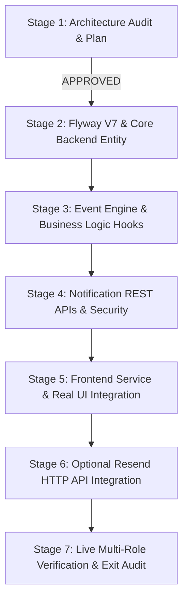

# CivicFix — Phase 5 Notification & Communication Implementation Plan
## Staged Engineering Roadmap: Persistent In-App Notifications & Decoupled Email Service

**Date:** 2026-10-23  
**Auditor & Architect:** Lead Software Architect, Full-Stack Engineer & QA Lead  
**Target Branch:** `feat/sprint3-frontend-backend-integration`  
**Database:** PostgreSQL 16.4 in Docker (`civicfix_postgres`), Host Port `5433`  
**Backend:** Java 21, Spring Boot 3.3.4, Maven Wrapper  
**Frontend:** React 18, Vite 5.4.21, Tailwind CSS  
**Implementation Standard:** Zero-cost core persistent notifications; non-destructive schema migration; no external API key requirement for core functionality.

---

## 1. Objectives & Scope

The objective of Phase 5 is to establish a secure, reliable, database-backed notification and communication system that informs citizens, municipal officers, field workers, and administrators about critical municipal events in real time.

### Core Objectives (Mandatory)
1. **Persistent PostgreSQL Storage**: Store all notifications in PostgreSQL via a new forward-only Flyway V7 migration.
2. **Event-Driven Decoupled Dispatch**: Use Spring `ApplicationEventPublisher` and `@TransactionalEventListener(phase = TransactionPhase.AFTER_COMMIT)` so that notification creation is completely decoupled from primary complaint transactions and never triggers on rolled-back transactions.
3. **Role-Specific Tenant Isolation**: Ensure citizens see only their complaints; officers receive municipal dispatch and verification notices; field workers receive their task assignments; admins receive platform governance alerts.
4. **Live REST APIs**: Provide endpoints for paginated notification retrieval, unread counts, marking individual notifications read, and marking all read.
5. **Real Frontend Integration**: Replace `localStorage` and `mockData.js` with live backend API calls in all 4 layout navigation bars and notification pages.
6. **Automated Deduplication**: Prevent notification flooding when rapid status updates or retries occur.

### Optional Enhancement (Decoupled)
1. **Resend HTTP API Email Delivery**: A modular, decoupled email delivery service that can be enabled via configuration (`civicfix.notifications.email.enabled: true`) without adding heavy third-party SDKs, defaulting to an offline logging fallback (`LoggingEmailService`).

---

## 2. Staged Implementation Roadmap



### Stage 1: Read-Only Architecture Audit & Implementation Plan (CURRENT STAGE)
- Inspect existing codebase, database, complaints lifecycle, and UI components.
- Evaluate core persistent in-app notifications and optional Resend HTTP API.
- Produce `docs/CIVICFIX_MASTER_ROADMAP.md`, `docs/PHASE_5_NOTIFICATION_ARCHITECTURE_AUDIT.md`, and `docs/PHASE_5_IMPLEMENTATION_PLAN.md`.
- **Safeguard:** Stop and await user review and approval before writing any code.

### Stage 2: Database Schema Migration & Core Backend Persistence
- **Task 2.1**: Create `backend/src/main/resources/db/migration/V7__create_notifications_table.sql`.
  - Add `notifications` table with columns: `id`, `recipient_id`, `actor_id`, `complaint_id`, `reference_id`, `title`, `message`, `notification_type`, `severity`, `target_url`, `is_read`, `read_at`, `created_at`.
  - Add compound indexes: `idx_notifications_recipient_unread (recipient_id, is_read, created_at DESC)` and `idx_notifications_complaint (complaint_id)`.
- **Task 2.2**: Implement `Notification` JPA entity in `backend/src/main/java/com/civicfix/notification/Notification.java`.
- **Task 2.3**: Implement `NotificationType` and `NotificationSeverity` enums.
- **Task 2.4**: Implement `NotificationRepository` with Spring Data JPA query methods (`findByRecipientIdOrderByCreatedAtDesc`, `countByRecipientIdAndIsReadFalse`, `markAllAsReadByRecipientId`).
- **Task 2.5**: Write database schema verification tests.

### Stage 3: Event-Driven Notification System & Business Logic Hooks
- **Task 3.1**: Create domain event class `ComplaintEvent` carrying complaint ID, reference ID, event type, actor ID, affected citizen ID, assigned worker ID, notes, and timestamp.
- **Task 3.2**: Implement `NotificationEventListener` annotated with `@TransactionalEventListener(phase = TransactionPhase.AFTER_COMMIT)`.
- **Task 3.3**: Implement `NotificationService` handling deduplication (checking if identical unread notification was issued within last 60 seconds), recipient resolution, and persistence.
- **Task 3.4**: Hook event publication into `ComplaintService`:
  - `createComplaint` -> fires `COMPLAINT_CREATED` (alerts citizen & officers)
  - `assignWorker` -> fires `WORKER_ASSIGNED` (alerts worker & citizen)
  - `transitionStatus(IN_PROGRESS)` -> fires `WORK_STARTED` (alerts citizen)
  - `transitionStatus(RESOLUTION_SUBMITTED)` -> fires `RESOLUTION_SUBMITTED` (alerts officer & citizen)
  - `transitionStatus(RESOLVED)` -> fires `COMPLAINT_RESOLVED` (alerts citizen & worker)
  - `transitionStatus(REWORK_REQUESTED)` -> fires `REWORK_REQUESTED` (alerts worker)
  - `transitionStatus(REJECTED)` -> fires `COMPLAINT_REJECTED` (alerts citizen)
  - `linkDuplicate` -> fires `DUPLICATE_LINKED` (alerts child citizen)
- **Task 3.5**: Add unit and integration tests verifying transactional safety (no notifications created if transaction rolls back).

### Stage 4: Notification REST APIs & Security
- **Task 4.1**: Create DTOs: `NotificationResponse`, `UnreadCountResponse`.
- **Task 4.2**: Implement `NotificationController` in `backend/src/main/java/com/civicfix/notification/NotificationController.java`:
  - `GET /api/notifications`: paginated list for authenticated user.
  - `GET /api/notifications/unread-count`: quick unread count for badges.
  - `PATCH /api/notifications/{id}/read`: mark individual item read with strict ownership check.
  - `PATCH /api/notifications/read-all`: mark all notifications read for caller.
- **Task 4.3**: Guard all endpoints with `@PreAuthorize("isAuthenticated()")` and verify ownership.
- **Task 4.4**: Write MockMvc integration tests for authentication, pagination, unread counts, and authorization rejection (HTTP 403 when user A tries to mark user B's notification read).

### Stage 5: Frontend Integration & Real UI Connection
- **Task 5.1**: Add `apiClient.notifications` module in `src/services/apiClient.js`:
  - `list(params)`: calls `GET /api/notifications`
  - `getUnreadCount()`: calls `GET /api/notifications/unread-count`
  - `markAsRead(id)`: calls `PATCH /api/notifications/{id}/read`
  - `markAllAsRead()`: calls `PATCH /api/notifications/read-all`
- **Task 5.2**: Update `src/context/AppContext.jsx`:
  - Replace static `localStorage` notifications with live backend fetch upon session login.
  - Expose `unreadNotificationCount`, `refreshNotifications()`, `markNotificationRead(id)`, `markAllNotificationsRead()`.
- **Task 5.3**: Update Layout Navigation Bars:
  - `CitizenLayout.jsx`: Connect badge to live `unreadNotificationCount`.
  - `OfficerLayout.jsx`: Connect badge to live `unreadNotificationCount`.
  - `WorkerLayout.jsx`: Add dynamic badge for unread dispatch notices.
  - `AdminLayout.jsx`: Add dynamic badge for admin alerts.
- **Task 5.4**: Update Notification Pages:
  - `CitizenNotificationsPage.jsx`: Connect to real API, display real ticket reference links (`/citizen/complaints/{referenceId}`).
  - `OfficerNotificationsPage.jsx`: Connect to real API, display real ticket review links (`/officer/complaints/{referenceId}/review` or verification queue).
  - `WorkerNotificationsPage.jsx`: Connect to real API, display real task links (`/worker/tasks/{referenceId}`).
  - `AdminNotificationsPage.jsx`: Connect to real API.
- **Task 5.5**: Add Vitest frontend tests covering API calls, state mapping, and error resilience.

### Stage 6: Optional Resend HTTP API Email Delivery Service
- **Task 6.1**: Define `EmailDeliveryService` interface:
  ```java
  public interface EmailDeliveryService {
      void sendEmail(String to, String subject, String htmlContent);
  }
  ```
- **Task 6.2**: Implement default `LoggingEmailService` (active when email disabled or key absent): logs email details cleanly without network requests.
- **Task 6.3**: Implement `ResendEmailService` using Spring Boot 3.3.4's built-in `RestClient` (zero third-party dependencies):
  - Target: `https://api.resend.com/emails`
  - Header: `Authorization: Bearer ${RESEND_API_KEY}`
  - Gated by: `@ConditionalOnProperty(name = "civicfix.notifications.email.enabled", havingValue = "true")`
  - Runs asynchronously inside `@Async` executor to prevent blocking user requests.
- **Task 6.4**: Document configuration template in `.env.example` and `application.yml`.
- **Safeguard**: Resend remains completely optional; no API key is required to build, test, or run the application.

### Stage 7: Comprehensive Multi-Role Verification & Exit Audit
- **Task 7.1**: Run complete backend Maven test suite (`.\mvnw.cmd test`).
- **Task 7.2**: Run complete frontend test suite (`npm.cmd test`).
- **Task 7.3**: Run production Vite build (`npm.cmd run build`).
- **Task 7.4**: Execute live multi-role verification script:
  1. Citizen submits complaint -> Citizen receives "Complaint Submitted", Officer receives "New Intake Defect".
  2. Officer assigns Marcus Chen -> Marcus receives "New Task Dispatched", Citizen receives "Technician Dispatched".
  3. Marcus begins work -> Citizen receives "Repair Underway".
  4. Marcus uploads evidence -> Officer receives "Resolution Proof Awaiting Verification".
  5. Officer approves resolution -> Citizen receives "Complaint Resolved", Marcus receives "Resolution Approved".
  6. Verify unread badge decrements on read actions.
  7. Verify citizen cannot read or access officer notifications (HTTP 403).
- **Task 7.5**: Inspect active PostgreSQL tables (`notifications`, `flyway_schema_history`).
- **Task 7.6**: Produce `docs/PHASE_5_FINAL_VERIFICATION_REPORT.md` and update `docs/CIVICFIX_MASTER_ROADMAP.md`.

---

## 3. Database Migration Specification

### File: `backend/src/main/resources/db/migration/V7__create_notifications_table.sql`

```sql
-- Flyway Forward-Only Migration V7: Create Persistent Notifications Table
-- Preserves all existing tables (V1-V6) and data without disruption.

CREATE TABLE notifications (
    id UUID PRIMARY KEY DEFAULT gen_random_uuid(),
    recipient_id UUID NOT NULL REFERENCES users(id) ON DELETE CASCADE,
    actor_id UUID REFERENCES users(id) ON DELETE SET NULL,
    complaint_id UUID REFERENCES complaints(id) ON DELETE SET NULL,
    reference_id VARCHAR(50),
    title VARCHAR(200) NOT NULL,
    message TEXT NOT NULL,
    notification_type VARCHAR(50) NOT NULL,
    severity VARCHAR(30) NOT NULL DEFAULT 'INFO',
    target_url VARCHAR(255),
    is_read BOOLEAN NOT NULL DEFAULT FALSE,
    read_at TIMESTAMP WITH TIME ZONE,
    created_at TIMESTAMP WITH TIME ZONE NOT NULL DEFAULT NOW()
);

-- Fast lookup for unread count badge & chronological paginated lists
CREATE INDEX idx_notifications_recipient_read_created 
ON notifications(recipient_id, is_read, created_at DESC);

-- Fast lookup for notifications linked to specific complaints
CREATE INDEX idx_notifications_complaint 
ON notifications(complaint_id);

-- Foreign key indexes
CREATE INDEX idx_notifications_recipient 
ON notifications(recipient_id);

CREATE INDEX idx_notifications_actor 
ON notifications(actor_id);
```

---

## 4. REST API Contract & DTO Specifications

### 1. `GET /api/notifications`
- **Security:** `@PreAuthorize("isAuthenticated()")`
- **Query Parameters:**
  - `page`: int (default `0`)
  - `size`: int (default `20`, max `50`)
  - `unreadOnly`: boolean (default `false`)
- **Response `200 OK`:**
  ```json
  {
    "success": true,
    "message": "Notifications retrieved successfully.",
    "data": {
      "content": [
        {
          "id": "123e4567-e89b-12d3-a456-426614174000",
          "title": "Work Order In Progress",
          "message": "Field technician Marcus Chen has begun repairs on complaint #CF-2026-87602.",
          "notificationType": "STATUS_CHANGED",
          "severity": "INFO",
          "referenceId": "CF-2026-87602",
          "targetUrl": "/citizen/complaints/CF-2026-87602",
          "isRead": false,
          "readAt": null,
          "createdAt": "2026-10-23T14:30:00Z"
        }
      ],
      "pageNumber": 0,
      "pageSize": 20,
      "totalElements": 1,
      "totalPages": 1,
      "last": true
    }
  }
  ```

### 2. `GET /api/notifications/unread-count`
- **Security:** `@PreAuthorize("isAuthenticated()")`
- **Response `200 OK`:**
  ```json
  {
    "success": true,
    "message": "Unread count retrieved.",
    "data": {
      "unreadCount": 3
    }
  }
  ```

### 3. `PATCH /api/notifications/{id}/read`
- **Security:** `@PreAuthorize("isAuthenticated()")`
- **Logic:** Validates that `notification.recipient_id == principal.getId()`. If mismatch, throws `HTTP 403 Forbidden`.
- **Response `200 OK`:**
  ```json
  {
    "success": true,
    "message": "Notification marked as read.",
    "data": {
      "id": "123e4567-e89b-12d3-a456-426614174000",
      "isRead": true,
      "readAt": "2026-10-23T14:35:00Z"
    }
  }
  ```

### 4. `PATCH /api/notifications/read-all`
- **Security:** `@PreAuthorize("isAuthenticated()")`
- **Logic:** Updates all `is_read = false` to `true` for caller's `recipient_id`.
- **Response `200 OK`:**
  ```json
  {
    "success": true,
    "message": "All notifications marked as read.",
    "data": {
      "updatedCount": 3
    }
  }
  ```

---

## 5. Security, Authorization & Privacy Rules

1. **Strict Recipient Filtering**: The query repository will strictly bind SQL queries to `WHERE recipient_id = :userId`. A user cannot view, paginate, count, or modify another user's notifications.
2. **Data Minimization**:
   - Notifications will only reference public ticket reference IDs, public municipal statuses, and defect categories.
   - PII such as citizen mobile numbers, passwords, emails, or internal authorization tokens will never be embedded in notification messages.
3. **Auditability**:
   - Marking notifications read or acknowledged does not delete the row; `read_at` is timestamped.
   - Audit trail records are created for critical notification events.

---

## 6. Acceptance Criteria for Phase 5 Completion

Phase 5 will be judged complete only when:
- [ ] Flyway V7 migration applies cleanly and adds `notifications` table to PostgreSQL.
- [ ] Core in-app notifications operate 100% offline without external API keys or third-party paid accounts.
- [ ] All 5 key lifecycle transitions in `ComplaintService` trigger corresponding notifications.
- [ ] Role isolation is verified: Citizen only sees their own notifications; Officer sees operational queue alerts; Worker sees assigned tasks.
- [ ] REST API endpoints return correct paginated JSON, unread counters, and handle authorization properly.
- [ ] Frontend UI consumes real backend endpoints; static `mockData.js` and `localStorage` notifications are fully decommissioned.
- [ ] Concurrency and duplicate-prevention guards prevent notification spam.
- [ ] Complete backend Maven test suite (`.\mvnw.cmd test`) passes.
- [ ] Complete frontend Vitest test suite (`npm.cmd test`) passes.
- [ ] Clean Vite production build passes.
- [ ] Live multi-role workflow test succeeds on the active environment.
- [ ] Final verification report `docs/PHASE_5_FINAL_VERIFICATION_REPORT.md` is approved.

---

## 7. Handover Checkpoint & Next Action

This plan is currently in **Stage 1 (Read-Only Audit & Plan)**. 
No implementation code has been written yet. All work has paused at this safeguard boundary.

### Next Action Requiring User Approval:
**Approve Stage 2**: Apply Flyway V7 migration and implement core backend notification persistence entities, repository, and DTOs.
