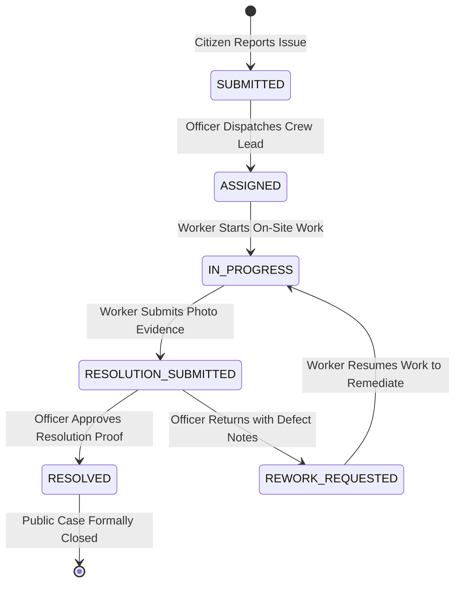

# CivicFix — Sprint 3, Step 4D Implementation Report
## Municipal Officer Verification and Rework

**Date:** 2026-10-22  
**Branch:** `feat/sprint3-frontend-backend-integration`  
**Status:** Complete  

---

### 1. Executive Summary

In Sprint 3, Step 4D, we connected the municipal officer verification and sign-off interface (`/officer/verifications` and `/officer/verifications/:complaintId`) to live Spring Boot endpoints backed by PostgreSQL. Authorized municipal officers (`ROLE_OFFICER` and `ROLE_ADMIN`) can now:

1. Review submitted repair work orders currently in `RESOLUTION_SUBMITTED` status.
2. Inspect genuine uploaded repair evidence photos, completion notes, and unverified device-reported GPS telemetry.
3. Adjudicate complaints by either approving the resolution (transitioning to `RESOLVED`) or returning the task for rework with a mandatory justification (transitioning to `REWORK_REQUESTED`).
4. Prevent unauthorized, conflicting, or out-of-order transitions, strictly enforcing workflow governance on the backend.
5. Provide immediate visibility of the outcome to citizens, whose complaint details and audit history reflect the final officer decision in real time.

---

### 2. Architecture & Workflow Governance

#### State Machine Transition Rules (Enforced in `ComplaintService.java`):
1. **Transition to `RESOLVED`:**
   - **Allowed source status:** Strictly `RESOLUTION_SUBMITTED`.
   - **Allowed personas:** `ROLE_OFFICER` or `ROLE_ADMIN`. (Citizens and field technicians receive `403 Forbidden`).
   - **Audit logging:** Records action `APPROVE_RESOLUTION` in `audit_logs` and writes a transition record to `complaint_status_history`.

2. **Transition to `REWORK_REQUESTED`:**
   - **Allowed source status:** Strictly `RESOLUTION_SUBMITTED`.
   - **Allowed personas:** `ROLE_OFFICER` or `ROLE_ADMIN`.
   - **Reason validation:** Rework reason cannot be empty or whitespace; missing note is rejected with `400 Bad Request`.
   - **Audit logging:** Records action `REQUEST_REWORK` in `audit_logs` and writes rework defect notes to `complaint_status_history`.

3. **Transition from `REWORK_REQUESTED` to `IN_PROGRESS`:**
   - Field worker can resume work (`IN_PROGRESS`) on a returned task (implemented in Step 4B and verified in Step 4D).

4. **Idempotency & Conflict Protection:**
   - Attempting to transition to the current status (e.g., duplicate `RESOLVED`) is rejected with `400 Bad Request` ("Complaint is already in status: RESOLVED").

---

### 3. Modifications by Component

#### A. Backend Changes

1. **`ComplaintService.java`**:
   - Enhanced `transitionStatus` method with:
     - Strict `RESOLUTION_SUBMITTED` prerequisite check for `RESOLVED` and `REWORK_REQUESTED`.
     - Required rework reason validation (`req.getNotes() != null && !req.getNotes().trim().isEmpty()`).
     - Distinct audit log action tagging (`APPROVE_RESOLUTION` and `REQUEST_REWORK`).
   - Updated `loadEvidenceFile(filename, principal)`:
     - Enforces authenticated access (`principal != null`).
     - Global access granted to `ROLE_ADMIN` and `ROLE_OFFICER`.
     - Fine-grained privacy check for citizens and workers: validates complaint ownership or task assignment via `ResolutionEvidenceRepository.findFirstByPhotoUrlContaining(filename)`.

2. **`ResolutionEvidenceRepository.java`**:
   - Added method `Optional<ResolutionEvidence> findFirstByPhotoUrlContaining(String filename)` to support fine-grained evidence file authorization.

3. **Backend Unit & Integration Tests**:
   - Created `ComplaintServiceOfficerTest.java` (12 unit tests):
     - `officerCanApproveResolutionFromSubmittedState`
     - `officerCanRequestReworkWithReason`
     - `officerReworkRequestRequiresNonEmptyReason`
     - `officerCannotApproveWhenNotInResolutionSubmitted`
     - `officerCannotRequestReworkWhenNotInResolutionSubmitted`
     - `workerCannotMakeOfficerDecisions`
     - `citizenCannotMakeOfficerDecisions`
     - `duplicateStatusTransitionRejected`
     - `adminCanAdjudicateResolution`
     - `loadEvidenceFileRequiresAuthentication`
     - `loadEvidenceFileEnforcesCitizenPrivacy`
     - `officerCanLoadEvidenceFile`
   - Updated `OfficerAssignmentIntegrationTest.java` with 4 database-backed integration tests:
     - `officerCanVerifyAndApproveSubmittedResolution` (end-to-end citizen report -> dispatch -> in progress -> evidence -> officer approve -> citizen view)
     - `officerCanReturnSubmittedResolutionForReworkWithReason` (full rework roundtrip)
     - `officerReworkRequestWithoutReasonIsRejected`
     - `workerAndCitizenCannotPerformOfficerSignOff`
   - Updated `WorkerTaskIntegrationTest.java` to align assertions with `Complaint is already in status` messages and proper complaint initialization.

#### B. Frontend Changes

1. **`src/services/complaintService.js`**:
   - Updated `mapBackendComplaintToFrontend(item)`:
     - Maps `item.evidence` (array of `ResolutionEvidenceResponse`) into `resolutionEvidence: { photos, notes, submittedDate, workerName, coordinates, evidenceList }`.
   - Updated `verifyResolution(id, decision, notes, officerName)`:
     - Calls live endpoint `apiClient.complaints.updateStatus(id, { status: 'RESOLVED' | 'REWORK_REQUESTED', notes })`.
     - Strictly re-throws 400, 401, 403, and 404 errors; only falls back to mock data if the backend is physically unreachable via network error.

2. **`src/services/officerService.js`**:
   - Added `getVerificationQueue(params)` querying `apiClient.complaints.list({ status: 'RESOLUTION_SUBMITTED' })`.
   - Added `getVerificationDetail(id)` calling `officerService.getComplaintDetail(id)` (combining complaint record and audit history).
   - Added `verifyResolution(complaintId, decision, remarks)` calling `apiClient.complaints.updateStatus`.

3. **`src/pages/officer/VerificationQueuePage.jsx`**:
   - Replaced in-memory filtering with `officerService.getVerificationQueue()`.
   - Added loading skeleton, error banner with retry button, and clear queue state.
   - Replaced false claims of RTK precision with honest disclosure: `"Field Evidence Attached (Device GPS Unverified)"`.

4. **`src/pages/officer/ResolutionVerificationPage.jsx`**:
   - Rewired from synchronous memory lookup to `officerService.getVerificationDetail(complaintId)`.
   - Added loading skeleton, error banner with retry button, and `submitting` state disabling double clicks.
   - Connected "Approve Resolution" button and "Request Corrections / Rework" modal to `officerService.verifyResolution`.
   - Labeled device GPS coordinates transparently: `"Device-Reported Telemetry (Unverified)"` displaying actual latitude and longitude.
   - Added "Workflow Status History & Audit Trail" section rendering all status transitions.

5. **Frontend Tests (`tests/officerService.test.js`)**:
   - Added 6 automated tests covering `getVerificationQueue`, `verifyResolution('APPROVE')`, `verifyResolution('REQUEST_REWORK')`, empty reason rejection, unsupported decision rejection, and 403 Forbidden propagation.

---

### 4. Verification & Test Results

#### 1. Frontend Test Suite (`npm.cmd test`)
- **Total Tests:** 64
- **Passed:** 64
- **Failed:** 0
- **Suites:** 7 (API Client, AuthService, ComplaintService, OfficerService, Phone Utilities, WorkerService, XSS Security)
- **Duration:** 382ms

#### 2. Frontend Production Build (`npm.cmd run build`)
- **Status:** Succeeded in 6.28s
- **Output:** `dist/index.html` (1.41 kB), `dist/assets/index-*.css` (70.45 kB), `dist/assets/index-*.js` (863.51 kB)

#### 3. Backend Unit & Database Integration Suite (`.\mvnw.cmd test`)
- **Total Tests:** 80
- **Passed:** 80
- **Failed:** 0
- **Skipped:** 0
- **Covered Suites:**
  - `com.civicfix.CivicFixApplicationTests` (1 test)
  - `com.civicfix.complaint.ComplaintAuthorizationIntegrationTest` (1 test)
  - `com.civicfix.complaint.ComplaintServiceOfficerTest` (12 tests)
  - `com.civicfix.complaint.ComplaintServiceWorkerTest` (24 tests)
  - `com.civicfix.complaint.OfficerAssignmentIntegrationTest` (11 tests against PostgreSQL)
  - `com.civicfix.complaint.WorkerTaskIntegrationTest` (15 tests against PostgreSQL)
  - `com.civicfix.security.PasswordHashingTest` (1 test)
  - `com.civicfix.storage.LocalStorageServiceTest` (9 tests)
  - `com.civicfix.auth.AuthControllerIntegrationTest` (6 tests)

---

### 5. Technical Safeguards & Disclosures

1. **Truthful Telemetry Labeling:**
   - In compliance with design rules, device coordinates are clearly disclosed as `"Device GPS: lat°, lng° (Unverified)"`. No fabricated claims of RTK or satellite precision are made.

2. **Citizen Outcome:**
   - When an officer approves or returns a ticket, the citizen-facing detail page (`ComplaintDetailsPage.jsx`) updates immediately:
     - `RESOLVED`: Advances the progress stepper to step 5 ("Verified Resolved"), displays green resolved badge, and includes the officer's approval note in status history.
     - `REWORK_REQUESTED`: Updates the badge to `REWORK_REQUESTED` and lists the officer's defect notes in the audit trail.
   - As instructed, email and SMS notifications are omitted in this step and reserved for a future notification provider implementation.

3. **Database Integrity:**
   - No database drops, resets, or volume deletions occurred. All state is persisted across existing tables (`complaints`, `resolution_evidence`, `complaint_status_history`, `audit_logs`).
