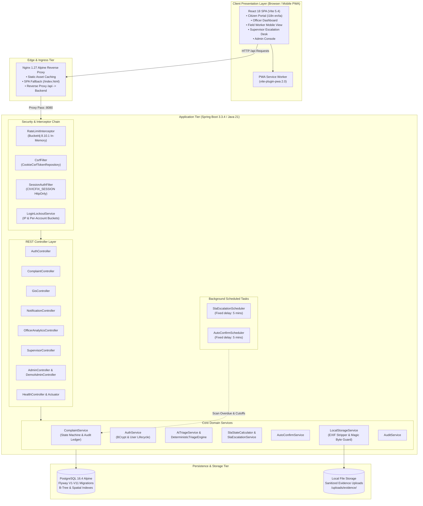

# CivicFix Technical Reference Document (TRD) — Final Architecture & System Specification

> **System Title**: CivicFix: An Explainable, Rule-Assisted Civic Complaint Platform with GIS Mapping and Citizen-Verified Resolution  
> **Document Status**: Production Specification (Verified against codebase)  
> **Target Version**: 1.0.0  
> **Classification**: Technical Reference

---

## 1. System Technology Stack & Versions

All versions below are directly pinned and verified against [`package.json`](file:///c:/Users/harsh/Downloads/stitch_civicfix_ai_platform_design/package.json), [`backend/pom.xml`](file:///c:/Users/harsh/Downloads/stitch_civicfix_ai_platform_design/backend/pom.xml), [`Dockerfile`](file:///c:/Users/harsh/Downloads/stitch_civicfix_ai_platform_design/Dockerfile), and [`docker-compose.yml`](file:///c:/Users/harsh/Downloads/stitch_civicfix_ai_platform_design/docker-compose.yml):

| Tier | Component | Exact Version | Purpose |
|---|---|---|---|
| **Frontend Framework** | React | `18.3.1` | Declarative UI component library |
| **Frontend Runtime** | React DOM | `18.3.1` | DOM renderer for React |
| **Build Tool & Dev Server** | Vite | `5.4.11` | ES-module build tool and local dev server |
| **Routing** | React Router DOM | `6.28.0` | Client-side routing and protected route guards |
| **Styling** | Tailwind CSS | `3.4.15` | Utility-first responsive design framework |
| **PostCSS** | PostCSS / Autoprefixer | `8.4.49` / `10.4.20` | CSS transformations and vendor prefixing |
| **Mapping & GIS** | Leaflet / react-leaflet | `1.9.4` / `4.2.1` | Interactive map tiles, markers, and coordinate picking |
| **Progressive Web App** | vite-plugin-pwa | `2.0.0` | Service worker generation and PWA manifest |
| **Production Web Server** | Nginx | `1.27-alpine` | Static asset serving and `/api` reverse proxying |
| **Backend Language** | Java (JDK) | `21` (LTS) | Backend runtime execution |
| **Backend Framework** | Spring Boot | `3.3.4` | Enterprise REST microservice platform |
| **Data Persistence** | Spring Data JPA / Hibernate | `3.3.4` (managed) | Object-relational mapping and repository abstraction |
| **Security Framework** | Spring Security | `3.3.4` (managed) | Session management, role-based authorization, BCrypt |
| **Input Validation** | Jakarta Validation (Hibernate) | `3.3.4` (managed) | Declarative DTO input validation |
| **Metrics & Health** | Spring Boot Actuator | `3.3.4` (managed) | Production health and readiness probes |
| **Database Engine** | PostgreSQL | `16.4-alpine` | Relational ACID storage with spatial indexing |
| **Schema Migration** | Flyway Core / Postgres | `10.18.0` | Declarative, version-controlled SQL migrations |
| **Rate Limiting** | Bucket4j Core | `8.10.1` | Token-bucket rate limiting and login lockout |
| **Orchestration** | Docker / Docker Compose | Compose Spec v3.8 | Multi-container reproducible runtime environment |

---

## 2. System Architecture Diagram



---

## 3. Database Schema & Migration Catalog (V1 to V11)

Every table and column is managed via Flyway versioned migrations under `backend/src/main/resources/db/migration/`:

```
V1__initial_schema.sql
V2__seed_roles_and_dev_users.sql
V3__add_complaint_photos.sql
V4__add_complaint_version.sql
V5__add_complaint_spatial_index.sql
V6__add_ai_triage_and_duplicate_tracking.sql
V7__create_notifications_table.sql
V8__add_is_demo_to_complaints.sql
V9__add_sla_policies_and_supervisor_role.sql
V10__add_citizen_confirmation_fields.sql
V11__add_evidence_location_check_fields.sql
```

### Table Definitions & Key Columns

#### 1. `roles` (V1, V9)
* **Purpose**: System security roles defining granular authority boundaries.
* **Key Columns**:
  * `id` (`INTEGER PRIMARY KEY`): Unique role ID.
  * `name` (`VARCHAR(50) UNIQUE NOT NULL`): `CITIZEN`, `OFFICER`, `WORKER`, `ADMIN`, and `SUPERVISOR` (added in V9).
  * `description` (`TEXT`): Human-readable role definition.
  * `created_at` (`TIMESTAMPTZ NOT NULL DEFAULT NOW()`): Creation timestamp.

#### 2. `users` (V1, V2)
* **Purpose**: User accounts across all platform personas.
* **Key Columns**:
  * `id` (`UUID PRIMARY KEY DEFAULT gen_random_uuid()`): Unique account identifier.
  * `full_name` (`VARCHAR(255) NOT NULL`): User's legal or preferred name.
  * `email` (`VARCHAR(255) UNIQUE`): Unique email address.
  * `phone_number` (`VARCHAR(20) UNIQUE`): Unique mobile number.
  * `password_hash` (`VARCHAR(255) NOT NULL`): BCrypt password hash (cost factor 10).
  * `is_active` (`BOOLEAN NOT NULL DEFAULT TRUE`): Administrative active/suspended status flag.
  * `created_at`, `updated_at` (`TIMESTAMPTZ NOT NULL DEFAULT NOW()`): Audit timestamps.

#### 3. `user_roles` (V1)
* **Purpose**: Join table establishing many-to-many relationship between users and roles.
* **Key Columns**:
  * `user_id` (`UUID NOT NULL REFERENCES users(id) ON DELETE CASCADE`): User reference.
  * `role_id` (`INTEGER NOT NULL REFERENCES roles(id) ON DELETE CASCADE`): Role reference.
  * Primary Key: `(user_id, role_id)`.

#### 4. `complaints` (V1, V4, V5, V6, V8, V9, V10)
* **Purpose**: Primary entity tracking civic complaints through their entire lifecycle.
* **Key Columns**:
  * `id` (`UUID PRIMARY KEY DEFAULT gen_random_uuid()`): Internal database ID.
  * `reference_id` (`VARCHAR(32) UNIQUE NOT NULL`): Citizen-facing identifier (e.g., `BLR-2026-0001`).
  * `citizen_id` (`UUID NOT NULL REFERENCES users(id)`): Submitting citizen.
  * `title` (`VARCHAR(255) NOT NULL`): Defect title.
  * `description` (`TEXT NOT NULL`): Detailed defect description.
  * `category` (`VARCHAR(100) NOT NULL`): Municipal category (`ROADS`, `WATER_SEWERAGE`, etc.).
  * `priority` (`VARCHAR(20) NOT NULL DEFAULT 'MEDIUM'`): `LOW`, `MEDIUM`, `HIGH`, `CRITICAL`.
  * `status` (`VARCHAR(50) NOT NULL DEFAULT 'SUBMITTED'`): Current workflow state.
  * `latitude`, `longitude` (`DECIMAL(10, 8)`, `DECIMAL(11, 8)`): Spatial coordinates.
  * `address` (`TEXT`), `ward` (`VARCHAR(100)`): Locality and municipal ward.
  * `assigned_worker_id` (`UUID REFERENCES users(id)`): Assigned field worker.
  * `assigned_officer_id` (`UUID REFERENCES users(id)`): Triaging officer.
  * `version` (`BIGINT NOT NULL DEFAULT 0`): Optimistic concurrency locking counter (V4).
  * `ai_detected_category`, `ai_recommended_priority` (`VARCHAR`): Keyword triage predictions (V6).
  * `ai_confidence` (`DECIMAL(5, 4)`): Triage engine confidence score [0.0000, 1.0000] (V6).
  * `ai_adjudication_status` (`VARCHAR(20) DEFAULT 'PENDING'`): `ACCEPTED`, `OVERRIDDEN`, `REJECTED` (V6).
  * `ai_explanation` (`TEXT`): Human-readable keyword match explanation (V6).
  * `duplicate_of_id` (`UUID REFERENCES complaints(id)`): Parent complaint pointer (V6).
  * `duplicate_confidence` (`DECIMAL(5, 4)`): Jaccard/spatial duplicate similarity (V6).
  * `duplicate_reason` (`TEXT`): Reason for duplicate linkage (V6).
  * `is_demo` (`BOOLEAN NOT NULL DEFAULT FALSE`): Isolated demo ticket flag (V8).
  * `sla_due_at` (`TIMESTAMPTZ`): Target resolution deadline (V9).
  * `escalated_at` (`TIMESTAMPTZ`): Timestamp when supervisor escalation triggered (V9).
  * `confirmation_requested_at` (`TIMESTAMPTZ`): Transition to `PENDING_CITIZEN_CONFIRMATION` (V10).
  * `confirmed_at` (`TIMESTAMPTZ`): Transition to `RESOLVED` (V10).
  * `auto_confirmed` (`BOOLEAN NOT NULL DEFAULT FALSE`): True if resolved by scheduler cutoff (V10).
  * `reopen_count` (`INTEGER NOT NULL DEFAULT 0`): Count of citizen rejections/reopens (V10).
  * `rejection_reason` (`TEXT`): Citizen or officer rejection reason (V1, V10).

#### 5. `complaint_photos` (V3)
* **Purpose**: Photos uploaded by citizens during complaint filing.
* **Key Columns**:
  * `id` (`UUID PRIMARY KEY DEFAULT gen_random_uuid()`): Photo record ID.
  * `complaint_id` (`UUID NOT NULL REFERENCES complaints(id) ON DELETE CASCADE`): Target complaint.
  * `photo_url` (`VARCHAR(500) NOT NULL`): Relative URL of sanitized image.
  * `caption` (`VARCHAR(255)`): Optional citizen caption.
  * `created_at` (`TIMESTAMPTZ NOT NULL DEFAULT NOW()`): Upload timestamp.

#### 6. `complaint_status_history` (V1)
* **Purpose**: Immutable chronological audit ledger of every complaint transition.
* **Key Columns**:
  * `id` (`UUID PRIMARY KEY DEFAULT gen_random_uuid()`): Ledger entry ID.
  * `complaint_id` (`UUID NOT NULL REFERENCES complaints(id) ON DELETE CASCADE`): Complaint reference.
  * `previous_status` (`VARCHAR(50) NOT NULL`): State before transition.
  * `new_status` (`VARCHAR(50) NOT NULL`): State after transition.
  * `changed_by_user_id` (`UUID REFERENCES users(id)`): Actor ID.
  * `changed_by_name` (`VARCHAR(255) NOT NULL`): Actor display name at transition time.
  * `notes` (`TEXT`): Transition explanation or location acknowledgement.
  * `created_at` (`TIMESTAMPTZ NOT NULL DEFAULT NOW()`): Audit timestamp.

#### 7. `resolution_evidence` (V1, V11)
* **Purpose**: Evidence uploaded by field workers upon repair completion.
* **Key Columns**:
  * `id` (`UUID PRIMARY KEY DEFAULT gen_random_uuid()`): Evidence record ID.
  * `complaint_id` (`UUID NOT NULL REFERENCES complaints(id) ON DELETE CASCADE`): Complaint reference.
  * `worker_id` (`UUID NOT NULL REFERENCES users(id)`): Uploading technician.
  * `photo_url` (`VARCHAR(500) NOT NULL`): Relative URL to sanitized image.
  * `evidence_notes` (`TEXT NOT NULL`): Worker description of repair work.
  * `latitude`, `longitude` (`DECIMAL(10, 8)`, `DECIMAL(11, 8)`): Work location coordinates.
  * `location_check_status` (`VARCHAR(30)`): `WITHIN_RANGE`, `OUT_OF_RANGE`, `LOW_ACCURACY`, `NOT_PROVIDED`, `NOT_CHECKABLE` (V11).
  * `device_latitude`, `device_longitude` (`DECIMAL(10, 8)`, `DECIMAL(11, 8)`): Hardware GPS coordinates (V11).
  * `device_accuracy` (`DECIMAL(8, 2)`): GPS accuracy in meters (V11).
  * `device_reported` (`BOOLEAN DEFAULT FALSE`): Hardware sensor vs manual entry (V11).
  * `distance_meters` (`DECIMAL(10, 2)`): Haversine distance from intake complaint coordinates (V11).
  * `location_note` (`TEXT`): Required explanation if GPS missing or out-of-range (V11).
  * `location_acknowledgement` (`TEXT`): Officer justification when approving out-of-range evidence (V11).
  * `created_at` (`TIMESTAMPTZ NOT NULL DEFAULT NOW()`): Evidence submission timestamp.

#### 8. `audit_logs` (V1)
* **Purpose**: System-wide administrative security event ledger.
* **Key Columns**:
  * `id` (`UUID PRIMARY KEY DEFAULT gen_random_uuid()`): Log event ID.
  * `user_id` (`UUID REFERENCES users(id)`): Acting user.
  * `user_name` (`VARCHAR(255)`), `user_role` (`VARCHAR(50)`): Actor context.
  * `action` (`VARCHAR(100) NOT NULL`): Operation (`LOGIN`, `CREATE_COMPLAINT`, `TRANSITION_STATUS`, etc.).
  * `entity_type` (`VARCHAR(50)`), `entity_id` (`VARCHAR(255)`): Target entity.
  * `details` (`TEXT`): Event metadata.
  * `ip_address` (`VARCHAR(45)`): Client IPv4 or IPv6 address.
  * `status` (`VARCHAR(20) NOT NULL DEFAULT 'SUCCESS'`): `SUCCESS` or `FAILURE`.
  * `created_at` (`TIMESTAMPTZ NOT NULL DEFAULT NOW()`): Log timestamp.

#### 9. `notifications` (V7)
* **Purpose**: Tenant-isolated in-app notification inbox.
* **Key Columns**:
  * `id` (`UUID PRIMARY KEY DEFAULT gen_random_uuid()`): Notification ID.
  * `user_id` (`UUID NOT NULL REFERENCES users(id) ON DELETE CASCADE`): Target recipient.
  * `title` (`VARCHAR(255) NOT NULL`): Notification subject.
  * `message` (`TEXT NOT NULL`): Body message.
  * `type` (`VARCHAR(50) NOT NULL DEFAULT 'INFO'`): Severity or category.
  * `complaint_id` (`UUID REFERENCES complaints(id) ON DELETE SET NULL`): Associated complaint.
  * `is_read` (`BOOLEAN NOT NULL DEFAULT FALSE`): Read status indicator.
  * `created_at` (`TIMESTAMPTZ NOT NULL DEFAULT NOW()`): Timestamp.

#### 10. `sla_policies` (V9)
* **Purpose**: Configurable service level agreement resolution deadlines per category and priority.
* **Key Columns**:
  * `id` (`UUID PRIMARY KEY DEFAULT gen_random_uuid()`): Policy ID.
  * `category` (`VARCHAR(100) NOT NULL`), `priority` (`VARCHAR(20) NOT NULL`): Target classification.
  * `resolution_window_hours` (`INTEGER NOT NULL`): Maximum hours allowed before overdue.
  * `warning_threshold_hours` (`INTEGER NOT NULL`): Hours threshold for `DUE_SOON`.
  * `active` (`BOOLEAN NOT NULL DEFAULT TRUE`): Policy toggle.
  * `created_at`, `updated_at` (`TIMESTAMPTZ NOT NULL DEFAULT NOW()`): Audit timestamps.

---

## 4. REST API Endpoint Catalog & Role Access Matrix

Permissions are verified directly against [`SecurityConfig.java`](file:///c:/Users/harsh/Downloads/stitch_civicfix_ai_platform_design/backend/src/main/java/com/civicfix/config/SecurityConfig.java) and `@PreAuthorize` annotations on individual controllers.

### 4.1 Authentication & Profile (`AuthController`)
| Method | Endpoint | Allowed Roles | Description |
|---|---|---|---|
| `POST` | `/api/auth/login` | Public (Rate-limited) | Authenticates credentials, creates session, checks lockout |
| `POST` | `/api/auth/register` | Public (Rate-limited) | Registers new citizen account |
| `GET` | `/api/auth/me` | Authenticated | Returns current authenticated user profile and roles |
| `POST` | `/api/auth/logout` | Authenticated | Invalidates HTTP session and clears security context |

### 4.2 Complaints Management (`ComplaintController`)
| Method | Endpoint | Allowed Roles | Description |
|---|---|---|---|
| `GET` | `/api/complaints/public/map` | Public | Returns privacy-sanitized, coordinate-rounded markers |
| `GET` | `/api/complaints/public/trust` | Public | Returns aggregated ward trust scores |
| `POST` | `/api/complaints` (JSON) | Authenticated | Files a new civic complaint |
| `POST` | `/api/complaints` (Multipart) | Authenticated | Files complaint with attached photos |
| `GET` | `/api/complaints` | Authenticated | Paged complaint list (Citizens see own; staff see all) |
| `GET` | `/api/complaints/{id}` | Authenticated | Fetches complaint details (enforces role-based ownership) |
| `GET` | `/api/complaints/{id}/history` | Authenticated | Fetches chronological status audit trail |
| `GET` | `/api/complaints/{id}/photos` | Authenticated | Fetches intake defect photos |
| `POST` | `/api/complaints/{id}/notes` | Worker, Officer, Admin | Appends a case note to complaint |
| `POST` | `/api/complaints/{id}/status` | Worker, Officer, Admin | Transitions workflow status (`IN_PROGRESS`, etc.) |
| `POST` | `/api/complaints/{id}/evidence` | Worker, Officer, Admin | Submits photographic repair evidence & GPS data |
| `GET` | `/api/complaints/{id}/evidence` | Authenticated | Fetches submitted repair evidence records |
| `GET` | `/api/complaints/evidence/files/{file}` | Authenticated | Downloads sanitized evidence photo from local storage |
| `POST` | `/api/complaints/{id}/confirm-resolution`| Owning Citizen Only | Confirms repair and transitions status to `RESOLVED` |
| `POST` | `/api/complaints/{id}/reject-resolution` | Owning Citizen Only | Rejects repair with reason; moves to `REWORK_REQUESTED` |
| `POST` | `/api/complaints/{id}/assign` | `OFFICER`, `ADMIN` | Assigns complaint to a field worker |

### 4.3 Officer Operations & Analytics (`OfficerAnalyticsController` & `ComplaintController`)
| Method | Endpoint | Allowed Roles | Description |
|---|---|---|---|
| `POST` | `/api/officer/complaints/{id}/adjudicate-triage` | `OFFICER`, `ADMIN` | Accepts or overrides AI category/priority suggestions |
| `POST` | `/api/officer/complaints/{id}/link-duplicate` | `OFFICER`, `ADMIN` | Links complaint as duplicate to primary master ticket |
| `GET` | `/api/officer/complaints/{id}/duplicate-candidates` | `OFFICER`, `ADMIN` | Fetches nearby potential duplicate candidates |
| `POST` | `/api/officer/complaints/{id}/verify-resolution` | `OFFICER`, `ADMIN` | Approves or rejects worker evidence |
| `GET` | `/api/officer/analytics/summary` | `OFFICER`, `ADMIN` | Officer performance, backlog, and SLA metrics |
| `GET` | `/api/officer/analytics/trust` | `OFFICER`, `SUPERVISOR`, `ADMIN` | Detailed ward trust index and resolution metrics |
| `GET` | `/api/officer/workers` | `OFFICER`, `ADMIN` | Lists eligible field workers for assignment |

### 4.4 Supervisor Escalations (`SupervisorController`)
| Method | Endpoint | Allowed Roles | Description |
|---|---|---|---|
| `POST` | `/api/complaints/{id}/escalate` | `SUPERVISOR`, `ADMIN` | Manually escalates stalled complaint to supervisor desk |
| `GET` | `/api/supervisor/escalations` | `SUPERVISOR`, `ADMIN` | Lists all escalated and overdue complaints |
| `POST` | `/api/supervisor/complaints/{id}/reassign` | `SUPERVISOR`, `ADMIN` | Reassigns stalled complaint to a different worker |
| `GET` | `/api/supervisor/workers` | `SUPERVISOR`, `ADMIN` | Lists active field workers for reassignment |

### 4.5 System Administration (`AdminController` & `DemoAdminController`)
| Method | Endpoint | Allowed Roles | Description |
|---|---|---|---|
| `GET` | `/api/admin/dashboard/summary` | `ADMIN` | System-wide statistics and role user counts |
| `GET` | `/api/admin/users` | `ADMIN` | Paged list of all system users |
| `POST` | `/api/admin/users` | `ADMIN` | Provisions municipal staff (Officer, Worker, Supervisor) |
| `GET` | `/api/admin/users/{id}` | `ADMIN` | Retrieves specific user profile |
| `PATCH`| `/api/admin/users/{id}/status` | `ADMIN` | Activates or suspends a user account |
| `GET` | `/api/admin/audit-logs` | `ADMIN` | Paged security and operational audit trail |
| `GET` | `/api/admin/sla-policies` | `ADMIN` | Lists configured SLA resolution policy targets |
| `POST` | `/api/admin/demo/reset` | `ADMIN` | Resets demo complaints to clean baseline state |
| `GET` | `/api/admin/demo/status` | `ADMIN` | Returns demo dataset counts and status |

### 4.6 Notifications (`NotificationController`)
| Method | Endpoint | Allowed Roles | Description |
|---|---|---|---|
| `GET` | `/api/notifications` | Authenticated | Paged notifications for current authenticated user |
| `GET` | `/api/notifications/unread-count` | Authenticated | Unread notification count for badge rendering |
| `PATCH`| `/api/notifications/{id}/read` | Authenticated | Marks a specific notification as read |
| `PATCH`| `/api/notifications/read-all` | Authenticated | Marks all user notifications as read |
| `POST` | `/api/notifications/mark-all-read` | Authenticated | Alternate POST endpoint to mark all read |

### 4.7 GIS & Health (`GisController`, `HealthController`, Actuator)
| Method | Endpoint | Allowed Roles | Description |
|---|---|---|---|
| `GET` | `/api/gis/reverse-geocode` | Public | Reverse geocodes coordinates to street address |
| `GET` | `/api/health` | Public | Basic backend liveness check (`status: UP`) |
| `GET` | `/actuator/health` | Public | Spring Boot Actuator health check |
| `GET` | `/actuator/info` | Public | Build and git metadata |

---

## 5. Complaint Lifecycle State Machine

This state machine diagram is generated directly from the transitions enforced in [`ComplaintService.java`](file:///c:/Users/harsh/Downloads/stitch_civicfix_ai_platform_design/backend/src/main/java/com/civicfix/complaint/ComplaintService.java):

```mermaid
stateDiagram-v2
    [*] --> SUBMITTED : Citizen submits complaint

    SUBMITTED --> ASSIGNED : Officer assigns worker
    SUBMITTED --> REJECTED : Officer rejects intake complaint

    ASSIGNED --> IN_PROGRESS : Assigned worker starts repair
    ASSIGNED --> ASSIGNED : Supervisor reassigns worker

    IN_PROGRESS --> RESOLUTION_SUBMITTED : Worker submits photo evidence & GPS

    RESOLUTION_SUBMITTED --> PENDING_CITIZEN_CONFIRMATION : Officer approves evidence\n(Requires acknowledgement if out-of-range)
    RESOLUTION_SUBMITTED --> REWORK_REQUESTED : Officer rejects evidence\n(With rework notes)

    REWORK_REQUESTED --> IN_PROGRESS : Worker resumes repair work
    REWORK_REQUESTED --> ASSIGNED : Officer / Supervisor reassigns worker

    PENDING_CITIZEN_CONFIRMATION --> RESOLVED : Owning citizen confirms resolution
    PENDING_CITIZEN_CONFIRMATION --> RESOLVED : Auto-confirm scheduler triggers (7 days)
    PENDING_CITIZEN_CONFIRMATION --> REWORK_REQUESTED : Citizen rejects resolution\n(10-500 char reason; reopen_count++)

    RESOLVED --> REOPENED : Owning citizen disputes within 30 days
    REOPENED --> ASSIGNED : Officer reassigns for remediation

    REJECTED --> [*]
    RESOLVED --> [*]
```



> [!IMPORTANT]
> **Direct Transition Prohibition**:
> As enforced in `ComplaintService.java` (line 595), attempting to directly transition any complaint from `SUBMITTED`, `ASSIGNED`, or `IN_PROGRESS` to `RESOLVED` throws a `ForbiddenException`:
> *"Complaints cannot be directly marked RESOLVED. Citizen confirmation or auto-confirmation is required."*

---

## 6. Security Design & Threat Mitigation

### 6.1 Session Management & Authentication
* **Session Cookie**: Uses standard Spring Security HTTP sessions with cookie name `CIVICFIX_SESSION`.
* **Cookie Flags**: Pinned to `HttpOnly` (mitigating XSS session theft) and `SameSite=Lax` (mitigating cross-site request forgery). In production profiles, `Secure=true` is enforced over TLS.
* **Authentication Storage**: `SecurityContextHolder` persists the principal in the session registry across requests.

### 6.2 CSRF Protection
* **Implementation**: `CookieCsrfTokenRepository.withHttpOnlyFalse()` issues an `XSRF-TOKEN` cookie readable by JavaScript.
* **Header Validation**: Frontend Axios/fetch interceptor sends this value in the `X-XSRF-TOKEN` header on all mutation requests (`POST`, `PUT`, `PATCH`, `DELETE`).

### 6.3 Password Hashing
* **Algorithm**: `BCryptPasswordEncoder` configured with work factor 10.
* **Salting**: Secure random salt generated per user; raw passwords never hit logs or persistent storage.

### 6.4 Rate Limiting & Denial-of-Service Defense
* **Library**: Bucket4j (`com.bucket4j:bucket4j-core:8.10.1`).
* **Storage Invariant**: In-memory `ConcurrentHashMap<String, Bucket>` managed by `RateLimiterService`.
  > [!WARNING]
  > **Single-Instance Limitation**: Because token buckets are kept in JVM heap memory, rate limiting state is reset on application restart and is not shared across multi-node clusters. A multi-instance production deployment requires a distributed Redis backing store.
* **Public Limits**:
  * Registration: 5 requests / 15 minutes per IP.
  * Login: 5 requests / 15 minutes per IP + identifier pair.

### 6.5 Login Lockout Service & Known Abuse Vector
* **Two-Tier Lockout**:
  1. *IP + Identifier Tier*: 5 failed attempts per 15 minutes.
  2. *Per-Account Tier*: 20 failed attempts per 1 hour across all IP addresses.
* **Known Abuse Vector**:
  > [!CAUTION]
  > Because the per-account lockout key is derived from the user-provided login identifier (email/phone), a malicious actor can intentionally lock out any legitimate victim user across the entire platform by sending 20 consecutive failed authentication requests using the victim's email address.

### 6.6 Upload Validation & Storage Defense
* **Size Enforcement**: Maximum 10MB per uploaded image.
* **Extension & Content-Type Agreement**: The declared HTTP MIME type must match the file extension (JPG/JPEG, PNG, WebP).
* **Path Traversal Defense**: Rejects filenames containing `..`, `/`, or `\`. Resolves files under a sandboxed directory and throws `BadRequestException` if paths escape root.
* **UUID Isolation**: Stored files are renamed to collision-resistant UUIDs (e.g., `evidence-550e8400-e29b-41d4-a716-446655440000.jpg`).

### 6.7 EXIF & Privacy Sanitization
* **JPEG & PNG**: Images are decoded into raw pixel rasters using `ImageIO.read()` and re-encoded via `ImageIO.write()`. This completely strips all camera metadata, EXIF tags, device serial numbers, and embedded GPS coordinates.
* **WebP Handling**:
  > [!NOTE]
  > For WebP files, `LocalStorageService` verifies RIFF/WEBP magic bytes and saves the raw payload directly without re-encoding. As a result, **EXIF metadata is NOT stripped for WebP files**.

### 6.8 Public Map Privacy Rounding
* **Coordinate Truncation**: Public GIS endpoints round coordinates to 3 decimal places using `RoundingMode.HALF_UP`:
  $$\approx 0.001^\circ \approx 111\text{ meters}$$
* **PII Redaction**: The public DTO (`PublicMapComplaintResponse`) strips citizen names, phone numbers, email addresses, detailed descriptions, internal officer notes, worker comments, reference IDs, and database UUIDs. It substitutes a sequential integer index (`1, 2, ...`).

### 6.9 Production Safety Guard & Seed Accounts
* **Startup Enforcement**: `ProductionSafetyGuard` activates strictly under the `prod` Spring profile.
* **Invariants Checked**:
  1. Refuses startup if the database password is empty or equals the development default (`civicfix_dev_password_only`).
  2. Disables the 4 V2 seed accounts (`Alex Morgan`, `Elena Vance`, `Marcus Chen`, `Priya Sharma`) unless `ALLOW_SEED_ACCOUNTS=true` is explicitly provided.

---

## 7. Operational Rules & Automations

### 7.1 SLA State Machine & Escalation Engine
* **SLA States** (`SlaState`):
  * `STOPPED`: Complaint is in a terminal state (`RESOLVED`, `REJECTED`).
  * `NOT_SET`: No `slaDueAt` calculated.
  * `OVERDUE`: Current time exceeds `slaDueAt` ($t > t_{\text{due}}$).
  * `DUE_SOON`: Remaining time is less than or equal to $\min(0.25 \times T_{\text{policy}}, 4\text{ hours})$.
  * `ON_TRACK`: Remaining time is outside the warning threshold.
* **Supervisor Escalation Scheduler**:
  * Runs every 5 minutes (`@Scheduled(fixedDelay = 300000)`).
  * Finds active, unresolved complaints where $t > t_{\text{due}}$ and `escalated_at IS NULL`.
  * Flags them as escalated, sets `escalated_at = NOW()`, appends an audit history entry, and routes the ticket to the Supervisor Escalation Desk.

### 7.2 Citizen Confirmation & Auto-Confirm Scheduler
* **Citizen Confirmation**:
  * When an officer approves worker evidence, status transitions to `PENDING_CITIZEN_CONFIRMATION`.
  * The reporting citizen can confirm resolution (`/confirm-resolution`), moving status to `RESOLVED` with `confirmed_at = NOW()`.
  * The citizen can reject resolution (`/reject-resolution`) by providing a mandatory 10-500 character explanation, which increments `reopen_count`, moves status to `REWORK_REQUESTED`, and notifies the assigned team.
* **Auto-Confirm Scheduler**:
  * Runs every 5 minutes (`@Scheduled(fixedDelay = 300000)`).
  * Scans for complaints that have remained in `PENDING_CITIZEN_CONFIRMATION` for longer than the configured window (default: 7 days).
  * Transitions them to `RESOLVED` with `auto_confirmed = true` and records an automated system transition in the audit history.

### 7.3 GPS Evidence Location Verification
* **Haversine Distance Check**:
  * When a field worker submits evidence with GPS coordinates, distance $d$ from the complaint intake coordinates is calculated using the Haversine spherical formula.
  * If $d \le 100\text{m}$, location status is marked `WITHIN_RANGE`.
  * If $d > 100\text{m}$, location status is marked `OUT_OF_RANGE`.
* **Worker Note Requirement**:
  * If GPS coordinates cannot be captured or are missing, worker must submit a `locationNote` of at least 10 characters explaining why GPS was unavailable.
* **Officer Acknowledgement Requirement**:
  * If evidence has any status other than `WITHIN_RANGE` (e.g. `OUT_OF_RANGE` or `NOT_PROVIDED`), the municipal officer approving the resolution must provide a mandatory `locationAcknowledgement` between 10 and 500 characters justifying why the out-of-range repair was accepted.

---

## 8. Keyword Triage Engine & Empirical Benchmark

### 8.1 Engine Implementation
* **Architecture**: The `DeterministicTriageEngine` is a deterministic, rule-based keyword matching engine utilizing a bilingual lexicon (English and Tamil tokens).
* **Token Matching**:
  * Computes word token sets from complaint titles and descriptions.
  * Applies **2x weighting** to title token matches.
  * Applies **3x weighting** to multi-word technical phrases (e.g., "water leakage", "கழிவுநீர்").
  * Predicts category and priority based on highest aggregate scoring token class.

### 8.2 Measured Empirical Benchmark
The engine was benchmarked against 100 synthetic test samples in [`docs/evaluation/results.md`](file:///c:/Users/harsh/Downloads/stitch_civicfix_ai_platform_design/docs/evaluation/results.md):

* **Category Accuracy**: `87.00%` (95% Wilson CI: `[79.02%, 92.24%]`) vs `19.00%` majority baseline.
* **Priority Accuracy**: `76.00%` (Macro-F1: `57.39%`) vs `43.00%` majority baseline.
* **Measured Priority Recall Imbalances**:
  * `CRITICAL`: 92.00% recall (23/25)
  * `HIGH`: 38.46% recall (10/26) — frequently under-prioritizes high defects lacking explicit arterial road tokens.
  * `MEDIUM`: 100.00% recall (43/43) — default baseline.
  * `LOW`: 0.00% recall (0/6) — engine lacks low-severity de-escalation rules, so all minor defects default to MEDIUM.
* **Duplicate Detection Rigor**:
  * Precision: `77.78%` (95% Wilson CI: `[45.26%, 93.68%]`).
  * Recall: `70.00%` (95% Wilson CI: `[39.68%, 89.22%]`).
  * Evaluated across only 10 true duplicate pairs; small sample size yields high statistical uncertainty.

